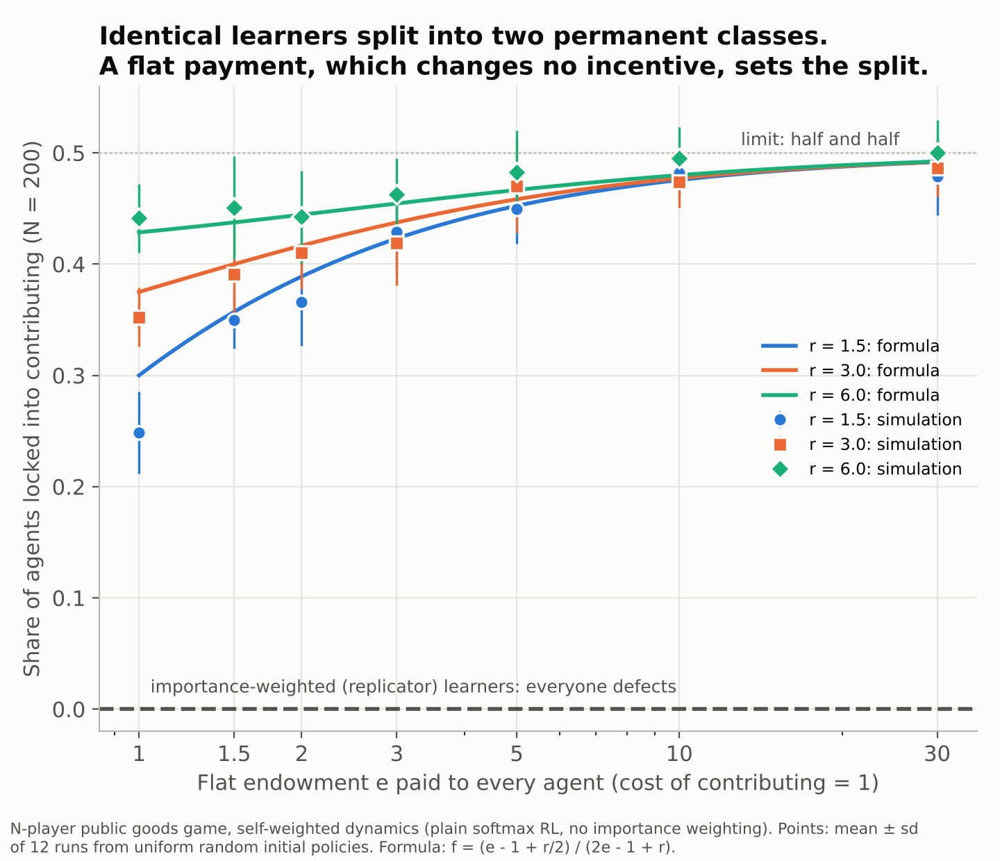

# Plain reinforcement learners split into permanent classes in a public goods game

A result about collective reinforcement learning dynamics, checked by simulation.

**Setting.** N identical agents play a linear public goods game. Each gets a flat endowment e, contributing costs 1, contributions are multiplied by r and shared equally. Defecting always pays more (1 < r < N). Each agent learns by softmax reinforcement learning.

**Result.** Two learning rules that differ only in a weighting factor behave in opposite ways.

- Importance-weighted learners (the replicator dynamics): everyone ends up defecting, as game theory predicts.
- Plain learners (no baseline, no importance weighting; the "self-weighted" dynamics): once e ≥ 1, the population splits. Some agents lock into contributing forever and earn 1 less than the defectors forever. Which agents? Exactly the ones whose initial probability of contributing was highest. The share of contributors follows a closed form, f = (e − 1 + r/2) / (2e − 1 + r), and tends to one half as e grows. The flat payment e changes no incentive, yet it sets the split.

**Why.** Under plain learning, a pure action profile is stable whenever every agent's reward at it is positive, not only when it is a strict Nash equilibrium. Plain learning acts like aspiration-based learning with the aspiration fixed at zero reward, so a flat payment shifts everyone's standing relative to that aspiration.

All numbers come from the scripts in `src/` and can be rerun with one command.

## Run it

```
./setup.sh      # installs numpy, pandas, matplotlib
./run_all.sh    # about 8 minutes; writes results/ and figures/
```

Python 3.10 or later. No data is downloaded; everything is simulated.

## Scripts

| Script | Does | Output |
|---|---|---|
| `src/dynamics.py` | The game, the two dynamics, the sampled learners, the formula | |
| `src/corner_rule.py` | Tests the stability rule on 40 random games with 2 to 4 agents and 2 to 3 actions | `results/corner_rule.json` |
| `src/pgg_sweep.py` | Outcome distribution across e, r, N; replicator control | `results/pgg_sweep.csv`, `replicator_control.json` |
| `src/formula_check.py` | Simulation vs formula at N = 200; who ends up contributing | `results/formula_check.csv` |
| `src/sampled_learners.py` | Real learners with sampled actions and rewards, N = 50 | `results/sampled_learners.json` |
| `src/figure.py` | Figure | `figures/split_vs_endowment.png`, `results/figure_data.csv` |

## The dynamics

In log-odds l of the probability p of contributing:

- plain (self-weighted): l += α (p R_C − (1 − p) R_D)
- importance-weighted (replicator): l += α (R_C − R_D)

with R_C = e − 1 + r(1 + m)/N and R_D = e + r m/N, where m is the expected number of other contributors. Expected rewards are linear in the others' probabilities, so the deterministic dynamics are exact for any N.

## Results



**Stability rule** (`corner_rule.json`). Across 1,111 non-marginal corners of random games, the plain dynamics attract a corner if and only if every agent's reward there is positive: 531 of 531 agree. The replicator attracts a corner if and only if it is a strict Nash equilibrium: 580 of 580 agree.

**Sweep** (`pgg_sweep.csv`, 150 runs per setting).
- Replicator, N = 50, r = 3, any e: all runs end with zero contributors.
- Plain, e ≥ 1, N ≥ 50: every run splits into contributors and defectors. At N = 20 the only setting below 100% is e = 1, r = 1.5 (97% of runs).
- Plain, e = 0.25 (a contributor earns a negative reward unless many others contribute): defection dominates, and it dominates more as N grows.
- No run ended unsettled, and no locked-in contributor ever had a non-positive reward.

**Formula** (`formula_check.csv`, N = 200, 20 runs per setting). Across 21 settings (e from 1 to 30, r in 1.5, 3, 6), the simulated share differs from the formula by at most 0.032 (at e = 1, r = 1.5) and by less than 0.01 in most settings. In all 420 runs, the agents who lock into contributing are exactly the agents with the highest initial probabilities.

**Sampled learners** (`sampled_learners.json`, N = 50, 12 runs). With noisy actions and rewards, every agent still locks in, the shares land near the formula (e = 3: 0.46 vs 0.44; e = 10: 0.50 vs 0.48; e = 1: 0.36 vs 0.38), and the correlation between initial probability and final choice is 0.82 to 0.86. Importance-weighted learners in the same setting: 12% contributors and falling.

## Derivation of the formula

Agent i locks into contributing when p_i R_C > (1 − p_i) R_D, that is when p_i > R_D / (R_C + R_D). Freeze the others' field at its initial mean of (N − 1)/2 contributors and let N be large: R_C = e − 1 + r/2 and R_D = e + r/2. With uniform initial probabilities the share above the threshold is 1 − R_D / (R_C + R_D) = (e − 1 + r/2) / (2e − 1 + r). The approximation is weakest when R_C is small (e near 1, small r), which is where the simulation departs most.

## What is and is not new

- The two-player version of the stability rule is known for aspiration-based learners: Izquierdo, Izquierdo and Gotts (JASSS 2008) note that the number of self-reinforcing equilibria equals the number of outcomes where both players exceed their aspirations.
- The link to the self-weighted collective learning dynamics, the N-player split, its formula and the ordering result were not found in a short literature search. They may exist elsewhere.

## Limits

- One game, one family of learning rules, uniform random initial policies.
- The formula is an approximation, not a theorem.
- Simulations use a fixed step size; the sweep uses α = 0.05 and up to 200,000 steps.

## License

MIT.
